# Home: análisis de twohalves.co

Analizado el 21/11/2026. Two Halves es un estudio de diseño y desarrollo de El Cairo fundado por **dos personas** (Aly Thabet y Ahmed El Shihy). Su web tiene sentido porque el concepto sale del nombre: "dos mitades". Eso es lo que tenemos que replicar: **la idea de la web sale de quiénes somos**, no de un efecto.

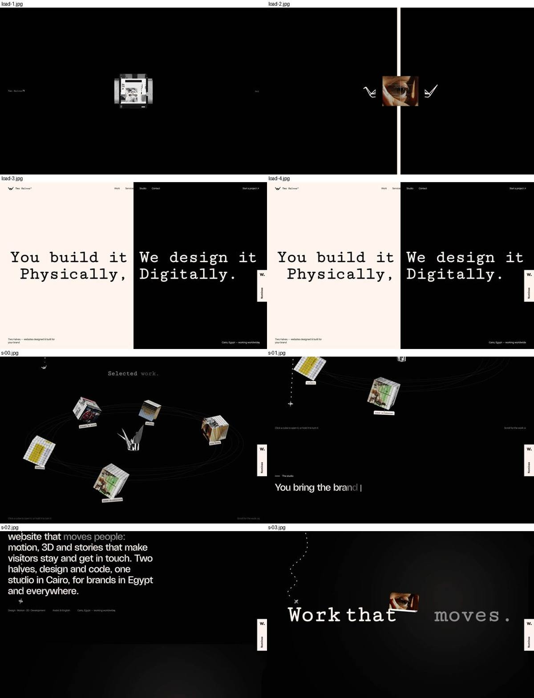

## Ficha técnica

| | |
|---|---|
| Framework | Next.js (Turbopack) |
| Scroll suave | Lenis |
| 3D | three.js / WebGL: un modelo `.glb` (grulla de origami) + 5 canvas |
| Video | Reels de cada caso en MP4 AV1 que se reproducen dentro de las tarjetas |
| Tipografías | **Cutive Mono** (titulares, efecto máquina de escribir) · **Aileron** (texto) · **NT Voice** (detalles) |
| Paleta | Negro `#000000` · crema `#FFF5EE` · grises `#9A9A9A` / `#6E6E6E` para la segunda mitad de cada titular |
| Largo | ~14.200 px en desktop (unas 16 pantallas) |
| Navegación | Work · Services · Studio · Contact + CTA "Start a project ↗" |

## Recursos que se repiten en toda la página
1. **Titulares tecleados.** Cada H2 aparece letra por letra en monoespaciada, con cursor `|`. La primera mitad va en blanco o negro y la segunda en gris ("Work that **moves.**", "Pick your **ticket.**").
2. **Objeto guía.** Una grulla de origami en 3D vuela por toda la página dejando una línea punteada. Une las secciones y da sensación de recorrido.
3. **Alternancia negro/crema.** Las secciones cambian de fondo, el mismo juego que el hero partido.
4. **Etiqueta de sección.** Una raya y un texto chico ("— Services") arriba de cada titular.
5. **Mucho aire.** Pocas palabras por pantalla y texto chico al lado de titulares grandes.

## Estructura, sección por sección

### 0. Loader (≈3 s)
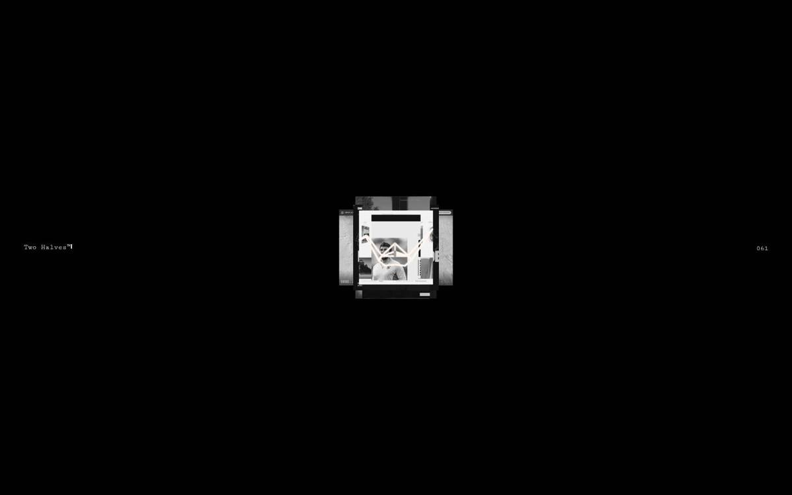
Fondo negro, collage de imágenes de proyectos que cambian dentro de un cuadrado y contador. Después aparece una línea vertical crema que **abre la pantalla en dos**.
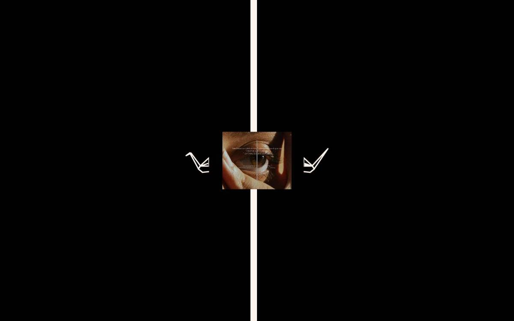

### 1. Hero partido
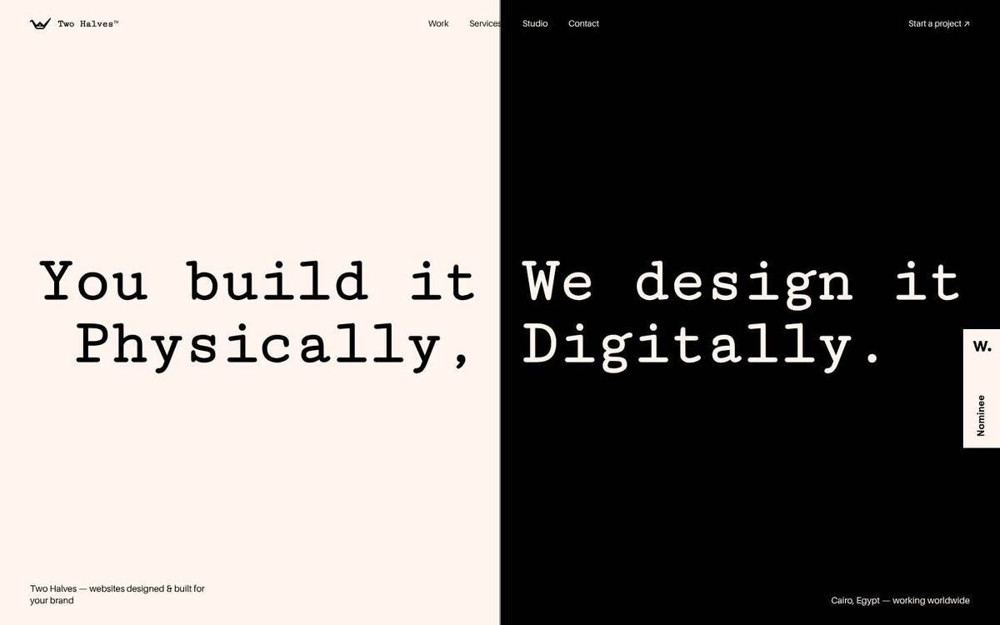
Mitad izquierda crema: "You build it **Physically**,". Mitad derecha negra: "We design it **Digitally**.". Monoespaciada enorme, menú fino arriba y microtextos en las esquinas inferiores (qué hacen / dónde están). **Es el corazón del concepto.**

### 2. Órbita de trabajos
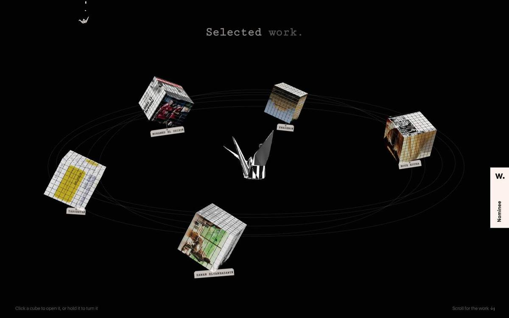
Cinco cubos 3D con capturas de proyectos giran en órbita alrededor de la grulla. Se puede hacer clic en un cubo para abrirlo o mantenerlo apretado para girarlo. Es el momento "juguete" de la home.

### 3. Manifiesto ("The studio")
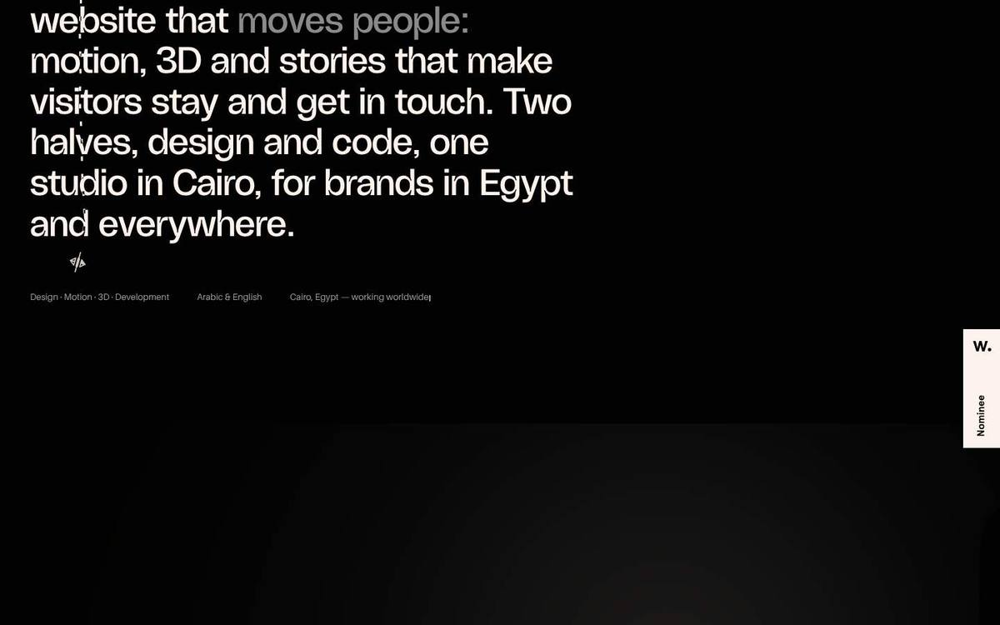
Un párrafo grande que se va revelando palabra por palabra al scrollear (las palabras pasan de gris a blanco). Debajo, tres datos chicos: disciplinas, idiomas y ubicación.

### 4. Work: stack de casos
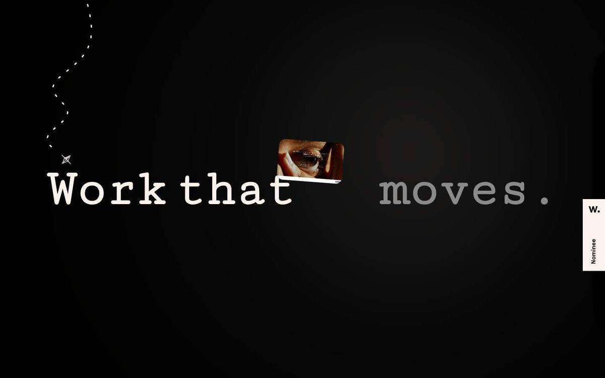
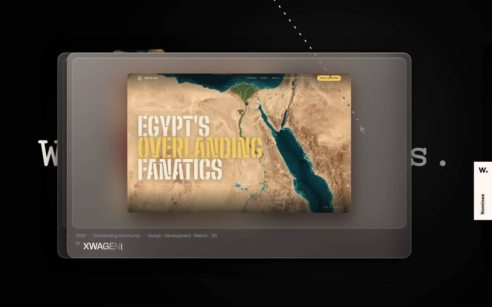
Primero el titular "Work that moves." enorme. Después cada caso es una tarjeta de vidrio esmerilado con el **video del sitio adentro**, que se apila sobre la anterior al scrollear (sticky stack). Abajo de cada una: estado (Live/2026/Soon), rubro, disciplinas, número y nombre.

### 5. Servicios
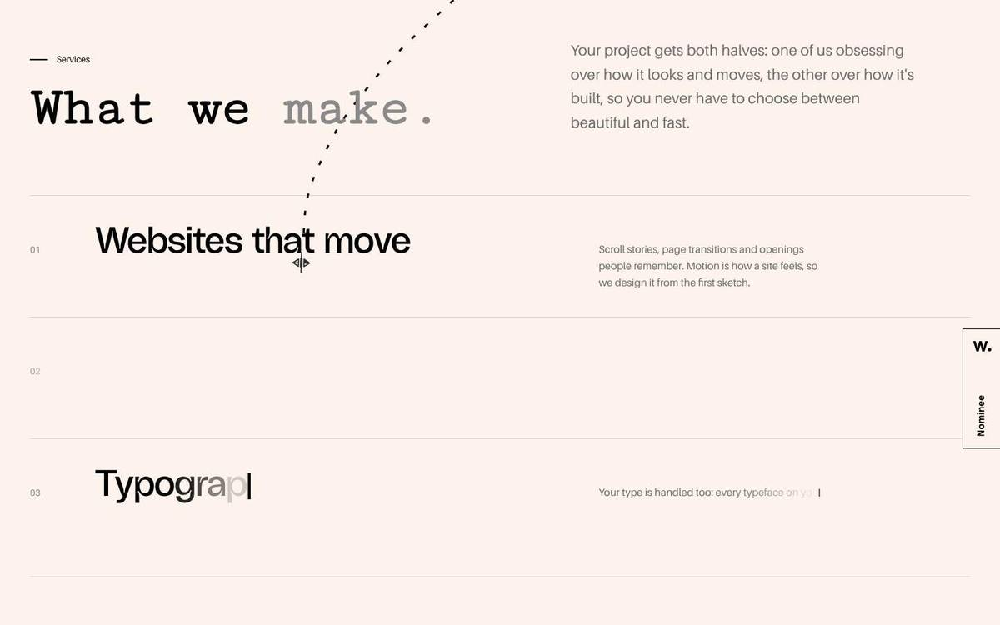
Fondo crema. Lista numerada 01–05 con filas separadas por líneas finas: el título del servicio a la izquierda y la descripción corta a la derecha. Los títulos se tipean al entrar.

### 6. Paquetes como tickets
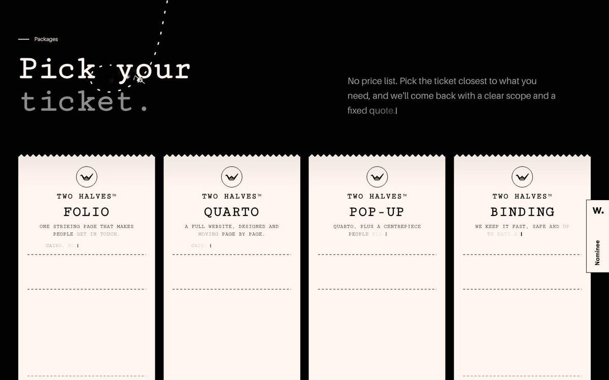
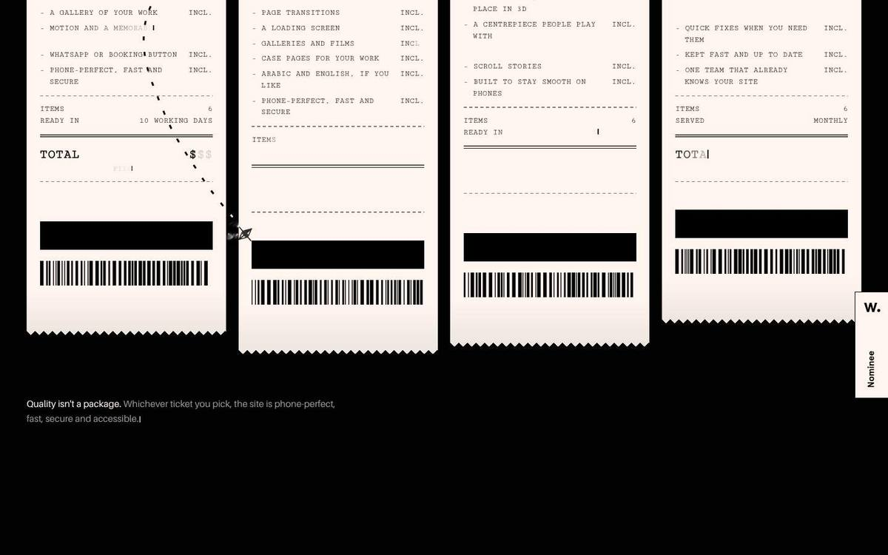
"Pick your ticket." Cuatro paquetes (FOLIO, QUARTO, POP-UP, BINDING) diseñados como **tickets de restaurante**: borde dentado, ítems "INCL.", fecha y hora reales, "SERVER: ALY & AHMED", "TOTAL $$$", "CHEF'S NOTE", código de barras. No muestran precio y piden cotización. Es el recurso más original de la página.

### 7. Proceso + equipo
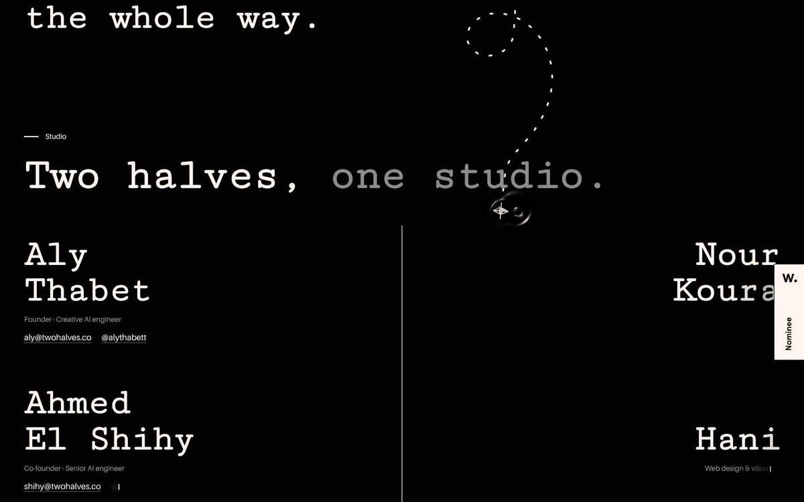
"We're with you the whole way." y después "Two halves, one studio.": nombres grandes en monoespaciada en dos columnas divididas por una línea vertical, con rol, mail y redes. Botón "More about us →".

### 8. CTA final
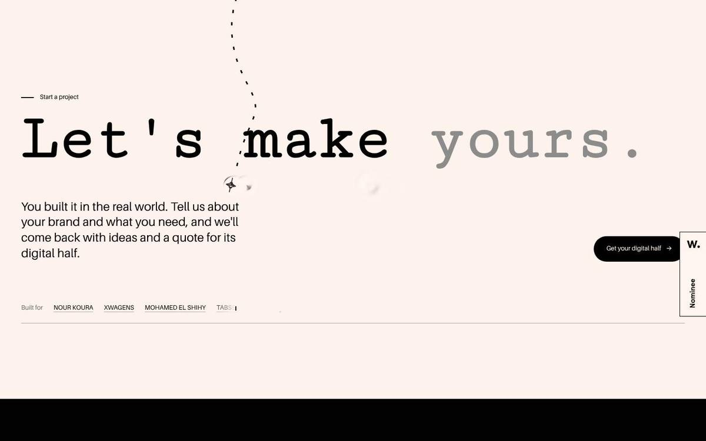
Fondo crema, "Let's make yours." enorme, una frase que remata el concepto ("Get your digital half →") y la lista de clientes "Built for".

### 9. Footer
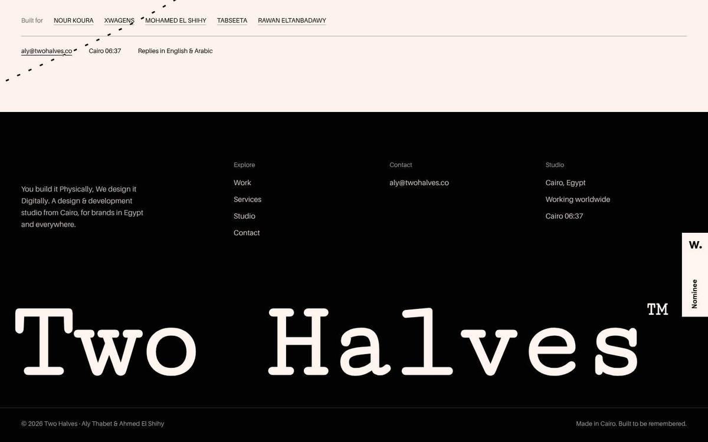
Negro. Columnas Explore / Contact / Studio, **reloj con la hora local de El Cairo** y el wordmark "Two Halves™" gigante de borde a borde.

### Mobile
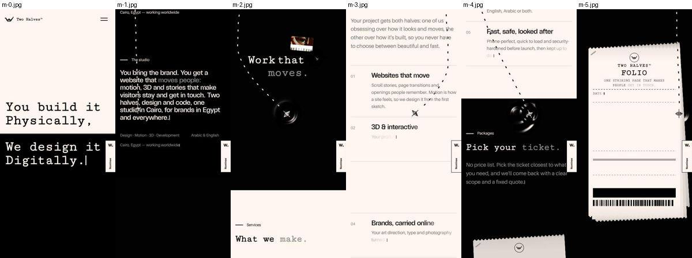
El hero se parte en horizontal (crema arriba, negro abajo), la órbita pasa a scroll vertical y los tickets se apilan. Mantiene todos los recursos.

## Qué se puede tomar y qué es de ellos

| Tomamos (técnica o estructura, de uso común) | No tomamos (identidad de Two Halves) |
|---|---|
| Orden narrativo: loader → hero con concepto → trabajos → manifiesto → servicios → paquetes → equipo → CTA → footer | La frase "You build it physically / we design it digitally" y la idea de "dos mitades" |
| Titulares con revelado y contraste de dos tonos | La grulla de origami y la línea punteada |
| Un objeto o elemento guía que recorre el scroll | Los paquetes como ticket de restaurante (FOLIO, CHEF'S NOTE, etc.) |
| Casos con video real adentro y stack sticky | La paleta negro + crema con Cutive Mono |
| Texto que se revela palabra por palabra | Los cubos en órbita |
| Footer con wordmark gigante y hora local | Sus textos |
