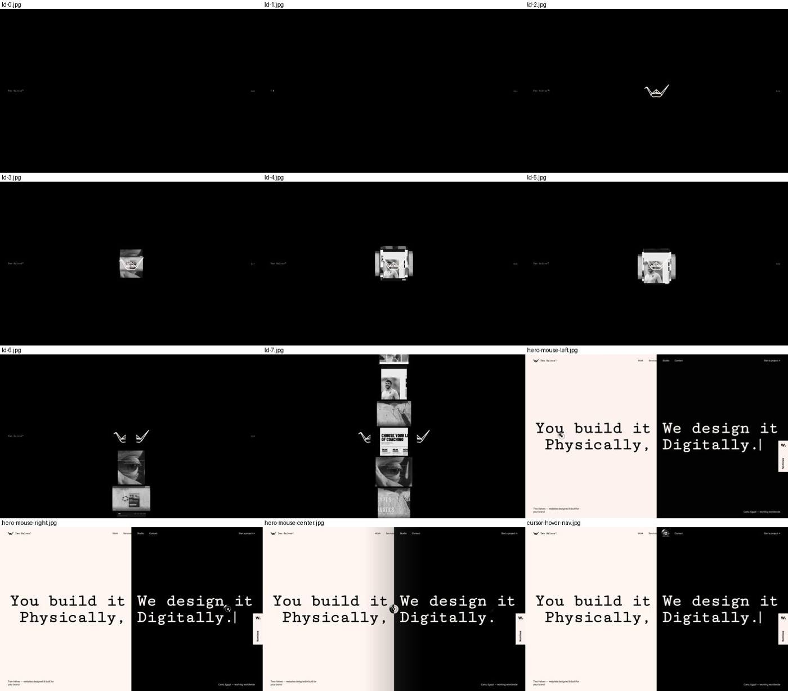
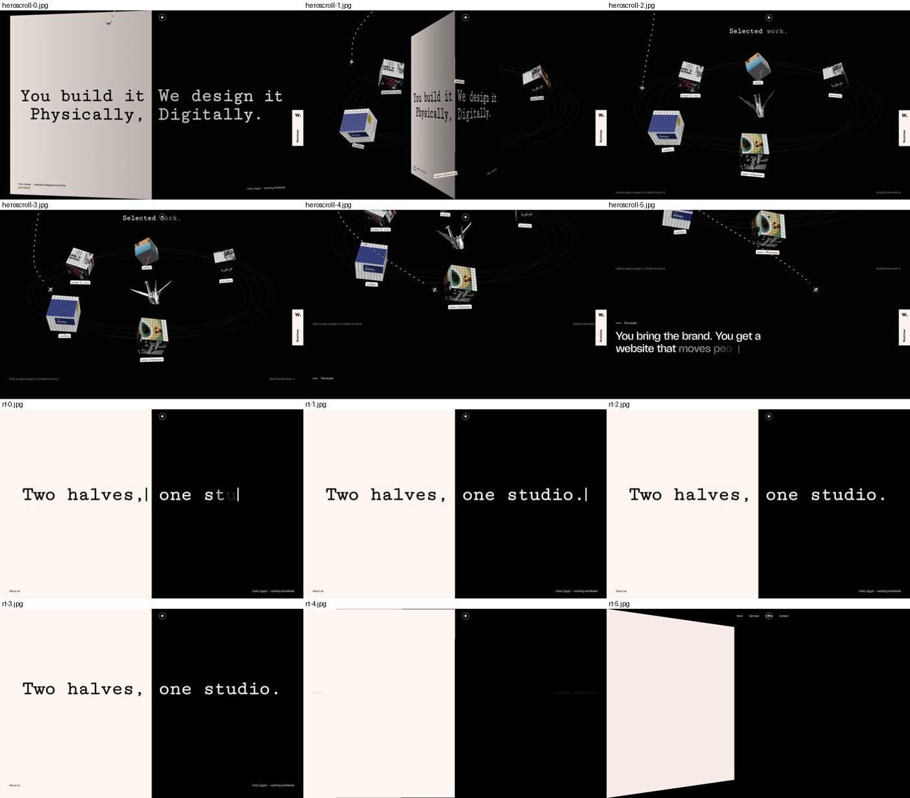

# Home: cómo está hecha twohalves.co por dentro

Análisis del 21/11/2026, hecho leyendo los archivos JavaScript y CSS que el sitio envía al navegador y grabando sus interacciones. Complementa [01-home-twohalves.md](01-home-twohalves.md), que describe la estructura visual.

> **Sobre "copiar".** Usamos las mismas librerías abiertas (Next.js, GSAP, Lenis, three.js) y las mismas *técnicas*. El código de Two Halves, sus shaders, su modelo 3D y sus textos son de ellos: escribimos los nuestros. Además, nuestro concepto (el mar) necesita otro código de todas formas.

## Stack

| Pieza | Qué usan | Para qué |
|---|---|---|
| Framework | Next.js (Turbopack) | Páginas, rutas, imágenes optimizadas, fuentes |
| Animación | GSAP 3.15 + ScrollTrigger + Draggable + InertiaPlugin | Todas las animaciones y lo que depende del scroll |
| Scroll suave | Lenis 1.3.26 (`lerp .14`), movido por el reloj de GSAP | Scroll "con peso" y sincronizado con las animaciones |
| 3D | three.js (carga diferida, recién después del loader) | Grulla cromada del hero, cubos en órbita, tickets arrugados en móvil |
| Efectos GPU | Shaders WebGL2 escritos a mano, sin three.js | Simulación de ondas de agua y brillo del vidrio |
| Video | MP4 AV1 con respaldo y póster | Previews de cada caso |
| Fuentes | `next/font`: Cutive Mono, Aileron, NT Voice | Titulares a máquina, texto y detalles |

## Capas fijas de la página
La página tiene varias capas apiladas que no se mueven con el scroll. Tres de ellas usan `mix-blend-mode: difference`, que invierte el color de lo que tienen debajo: por eso el pájaro y el cursor se ven negros sobre crema y blancos sobre negro.

| Capa | Qué es |
|---|---|
| `canvas.pond` (atrás de todo) | Simulación de ondas de agua en WebGL2 |
| `canvas.water` | Ondas sobre el texto del hero |
| `canvas.flight` | La grulla en vuelo con su estela punteada (canvas 2D) |
| `cur-dot` / `cur-ring` | Cursor propio |
| `.rt` | Telón de la transición entre páginas |
| `.ld` | Loader |

## Efecto por efecto

### 1. Loader (dificultad media)
- Es una sola timeline de GSAP con `expo.inOut`.
- Primero el contador sube de 000 a 040 mientras el logo de la grulla se dibuja trazo a trazo (técnica `strokeDashoffset` en SVG).
- Después **se pausa hasta que cargan las fuentes y las 10 imágenes**, con un máximo de 5 s. Así nunca muestra la página a medias.
- Las imágenes aparecen en gris, forman una tira, una recupera el color y se "pliega".
- A los ~4.9 s dispara un evento (`th:loaded`) que arranca el scroll, el texto y el 3D.
- Si el usuario toca, scrollea o aprieta una tecla, se acelera ×4.
- Solo aparece en la primera visita. Con "reducir movimiento" activado no aparece.

### 2. Hero "hoja doblada" (media)
- Es **CSS 3D**, no WebGL: perspectiva de 1700 px y dos mitades que giran ±96° sobre el pliegue.
- La sección queda fija (ScrollTrigger `pin` + `scrub`) durante 1.1 pantallas de scroll.
- **El efecto de agua que vieron al pasar el mouse es este:**
  1. El texto del hero se dibuja en un canvas.
  2. Ese canvas pasa a ser la imagen de un shader de ondas.
  3. Al mover el cursor, las letras se refractan como si estuvieran bajo el agua.
- Debajo hay una escena three.js con la grulla cromada: modelo `.glb` con huesos para las alas y reflejos generados por código, sin descargar imágenes HDR.
- En celular no hay pliegue: el hero es estático.

### 3. Texto a máquina de escribir (media)
- Es un motor propio que recorre **todo el texto del sitio**.
- Divide cada texto en letras y las muestra de a una, con un cursor `|` que parpadea.
- La velocidad depende del tamaño de la letra: entre 4 y 38 ms por carácter, y ningún bloque tarda más de 1 s.
- Arranca cuando el texto entra en pantalla.
- Tiene "carriles" para encadenar textos: primero el título, después la bajada.
- El segundo tono de los titulares es solo una clase CSS en gris.

### 4. Manifiesto (baja)
El mismo troceo de letras, pero atado al scroll: la letra avanza a medida que bajás.

### 5. La grulla que recorre la página (alta)
- Es un **canvas 2D**, no 3D. La grulla es un origami calculado por código, con 11 fases de plegado, y se dibuja en perspectiva sin usar three.js.
- **Sale del logo del menú**, que se esconde mientras ella vuela.
- **Recorrido:**
  - Una ruta pseudoaleatoria con semilla, así que es siempre la misma.
  - Tiene espirales, ondas y zigzag sobre la sección de trabajos.
  - Está ligada a la posición del scroll.
- **Estela punteada:** queda fija en la ruta.
- **Aleteo:** depende de la distancia recorrida, no del tiempo. Si no scrolleás, no aletea.
- **Rendimiento:** solo se redibuja cuando hay scroll.
- **Agua de fondo (`pond`):**
  - Es una simulación física de ondas en la GPU (texturas que se alternan cuadro a cuadro).
  - La agitan la grulla, el mouse y, en celular, un video.
  - En celulares baja la resolución y usa el modo de bajo consumo.

### 6. Cubos en órbita (alta) · **la sacamos**
Cubos hechos de 488 cubitos con fotos de los proyectos. Se pueden arrastrar y, al hacer clic, explotan antes de abrir el caso.

### 7. Stack de casos (media)
- **Desktop:**
  - La sección queda fija y las tarjetas entran una por una, oscureciendo las anteriores.
  - Efecto vidrio con `backdrop-filter: blur(40px)`. Truco de rendimiento: a la tarjeta que queda tapada le sacan el blur.
  - Inclinación 3D de ±7° que sigue al mouse, con brillo que sigue al cursor y rebote elástico al salir.
- **Videos:**
  - Una preview flotante que sigue al cursor sobre cada caso. Solo descarga el video cuando hace falta.
  - Un video adentro del título que rebota como el logo del DVD.
- **Celular:** filas que se apilan solo con CSS (`position: sticky`).

### 8. Servicios y tickets
- **Servicios (baja):** grilla CSS; el título se pone gris al pasar el mouse.
- **Tickets en desktop (baja):**
  - Solo CSS: el ticket "se imprime" de arriba hacia abajo en 30 pasos.
  - Los dientes del borde son máscaras `conic-gradient`.
  - La fecha y hora son reales, con la zona horaria de El Cairo.
- **Tickets en celular (alta):** un taco de tickets grapados. Al scrollear se arrancan, se arrugan en 3D y salen volando.

### 9. Cursor (baja)
- Un punto y un aro con `mix-blend-mode: difference`. El aro sigue al punto con retraso (0.38 s).
- Crece sobre los links y muestra una etiqueta que se tipea ("Open · hold to turn").
- Botones "magnéticos": se acercan al cursor hasta 22 px.
- Solo aparece en computadoras con mouse.

### 10. Menú, transición entre páginas y scroll
- **Menú:** se esconde al bajar y aparece al subir. Cambia de color según la sección que tiene debajo.
- **Transición propia** (no usa la API View Transitions del navegador):
  1. Intercepta los clics en links internos.
  2. Cierra el telón de dos mitades.
  3. Escribe el título de la página de destino.
  4. Navega y vuelve a abrir el telón.
- Tiene un plan B: si algo falla, a los 9 s navega igual.
- **Menú móvil:** pantalla completa, bloquea el resto de la página, se cierra con Escape y maneja bien el foco.

### 11. Footer (baja)
El nombre gigante, a 15.6vw, se escribe letra por letra. Muestra un reloj con la hora local.

### 12. Formulario de cotización (baja)
- Campos de nombre, email, teléfono, marca, link y necesidad.
- Chips para elegir paquete y plazo.
- Campo trampa invisible contra bots, y además mide cuánto tardó la persona en completarlo.
- Si falla el envío, ofrece mandar un mail.

### 13. Calidad
- Respeta "reducir movimiento" en casi todo.
- El texto viene completo en el HTML, así que Google lo lee.
- Tiene una política de seguridad de scripts (CSP).
- No encontramos analítica ni datos estructurados (JSON-LD). **Nosotros sí los vamos a poner.**

## Qué nos llevamos, traducido al mar

| De Two Halves | En QC (concepto "inmersión") | ¿Se queda? |
|---|---|---|
| Loader con contador y logo que se dibuja | El contador marca **metros de profundidad**, la ballena se dibuja trazo a trazo y el agua sube hasta cubrir la pantalla | Sí |
| Hero que se dobla con el scroll | **Rompemos la superficie del agua:** al scrollear, la cámara se hunde y pasamos de la superficie a la zona de luz | Sí, con otra mecánica |
| Ondas de agua sobre el texto y de fondo | Es nuestro efecto principal: el cursor genera ondas en todo el sitio | Sí, es la base de la marca |
| Texto a máquina de escribir | Lo mantenemos como **lectura de sonar**: monoespaciada, con cursor parpadeante | Sí |
| Manifiesto que se revela con el scroll | Igual | Sí |
| Grulla que sale del logo y recorre la página | **La ballena** sale del logo, baja nadando con el scroll y deja una **estela de burbujas** en vez de puntos; aletea según cuánto avanza | Sí, rehecha |
| Cubos 3D en órbita | — | No |
| Stack de casos con vidrio | Tarjetas como **vidrio bajo el agua**, con preview de video que sigue al cursor y botón "Ver portfolio completo" | Sí |
| Tickets de paquetes | Otro formato, a definir. El ticket es identidad de ellos | Cambia |
| Cursor con inversión de color | Aro que deja una onda al moverse y burbujas sobre los links | Sí |
| Telón de dos mitades entre páginas | **Ola que barre la pantalla** y escribe el nombre de la página de destino | Sí, rehecha |
| Footer con nombre gigante y reloj | **El fondo del mar**, con hora de Buenos Aires y Madrid | Sí |
| Formulario con anti-bots | Igual, pero conectado a **GHL** | Sí |
| — | **Sonido opcional:** canto de ballena, ping de sonar en el contacto, ambiente submarino | Nuevo |
| — | **Medidor de profundidad** como indicador de scroll | Nuevo |

## Decisiones tomadas hasta ahora
- **Paleta:** negro casi absoluto, blanco y azul o cian. La bioluminiscencia como cuarto color, solo en el abismo.
- **Recorrido de la home:** superficie → zona de luz → zona crepuscular → abismo.
- **Animal guía:** ballena.
- **Sonido:** opcional, con botón.
- **Sin cubos 3D.**
- **Construcción:** Opus para análisis y marca; Fable para construir la web.
- **Hosting:** Cloudflare (Workers con assets estáticos). **Framework propuesto:** Astro (de Cloudflare desde enero 2026) + GSAP + Lenis + three.js/WebGL; formulario por un endpoint en el Worker que manda a GHL. Pendiente de confirmación.
- **Nombre:** Ceto Studio, dominio sugerido cetostudio.com (diosa griega de las ballenas y criaturas de las profundidades).
- **Idiomas:** español neutro latinoamericano + inglés. Público de la home: negocios de servicios y profesionales; agencias en página aparte.
- **Paquetes:** tickets de buceo o excursión ("pase de inmersión"), nombres y precios a definir.
- **Portfolio:** estética de las tarjetas de vidrio apiladas de Two Halves; la sección se construye con contenido de ejemplo y después se conectan sus webs.
- **Portfolio:** sus webs publicadas.
- **Pendiente:** tipografías, nombres/precios de paquetes, título del hero.
